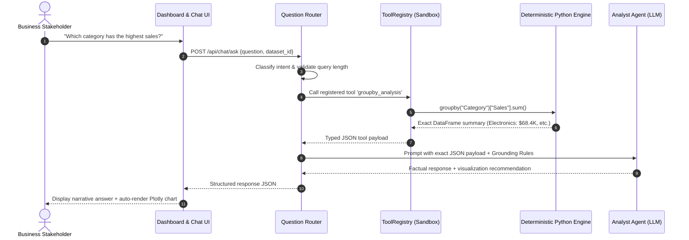

# 🤖 AI Data Analyst Agent

[](https://www.python.org/)
[](https://flask.palletsprojects.com/)
[](https://pandas.pydata.org/)
[](https://plotly.com/)
[](tests/)
[-blueviolet?style=for-the-badge&logo=shield&logoColor=white)](#-security)
[](LICENSE)
[](https://render.com/deploy?repo=https://github.com/aditya-puri90/AI-Analyst-Agent)

An enterprise-grade, portfolio-ready **Autonomous AI Data Analyst Agent** web application. It transforms raw, arbitrary CSV datasets into comprehensive exploratory data analysis (EDA), data quality audits, parametric and non-parametric statistics, interactive Plotly visualizations, automated data cleaning pipelines, natural language AI insights with strict deterministic grounding, intelligent analysis planning, and publication-ready multi-format executive reports.

---

### 🏷️ GitHub Topics & Tags
`data-analyst` • `ai-agent` • `exploratory-data-analysis` • `eda` • `data-cleaning` • `pandas` • `scipy` • `scikit-learn` • `flask` • `plotly` • `llm` • `gemini-api` • `business-intelligence` • `data-science` • `portfolio-project` • `automated-eda` • `waitress` • `docker`

---

## 📌 Table of Contents

- [Overview](#-overview)
  - [AI Agent vs. Traditional Dashboard](#-ai-agent-vs-traditional-dashboard)
- [Problem Statement](#-problem-statement)
- [Features](#-features)
- [Architecture](#-architecture)
- [Tech Stack](#-tech-stack)
- [How It Works](#-how-it-works)
- [Installation](#-installation)
- [Environment Variables](#-environment-variables)
- [Running Locally](#-running-locally)
- [Example Workflow](#-example-workflow)
- [Screenshots](#-screenshots)
- [Analysis Capabilities](#-analysis-capabilities)
- [AI Agent Architecture](#-ai-agent-architecture)
- [Security](#-security)
- [Testing](#-testing)
- [Future Improvements](#-future-improvements)
- [Project Structure](#-project-structure)
- [Author](#-author)

---

## 📖 Overview

The **AI Data Analyst Agent** bridges the gap between raw, messy real-world datasets and high-impact strategic business decision-making. Built from the ground up with clean architecture, enterprise security hardening, and production-grade WSGI support, the application automates the full data analysis lifecycle from ingestion to executive delivery.

Unlike fragile LLM wrappers that fabricate metrics or execute dangerous unvetted code, this system is anchored by a **dual-layer architecture**:
1. **Deterministic Computation Layer**: Powered by Pandas, NumPy, SciPy, and Scikit-learn, calculating 100% mathematically verified statistical distributions, correlations, data hygiene audits, and outlier bounds.
2. **Cognitive Reasoning Layer**: Powered by state-of-the-art LLMs (Google Gemini, OpenAI GPT-4o, Anthropic Claude) and a robust offline deterministic fallback engine, contextualizing empirical findings into strategic executive narratives and answering user queries strictly through controlled tool invocation.

```
       CSV Dataset Upload
               │
               ▼
┌─────────────────────────────────────────────────────────────┐
│              DETERMINISTIC ANALYTICS CORE                   │
│   Schema Inference • 12-Point Hygiene • Parametric Stats    │
│    Pearson Correlation • IQR/Z-Score Outlier Detection      │
└──────────────────────────────┬──────────────────────────────┘
                               │ Structured Grounded Context
                               ▼
┌─────────────────────────────────────────────────────────────┐
│                 COGNITIVE REASONING AGENT                   │
│  Zero RCE Tool Registry • Analysis Planner • Natural Q&A   │
│         Executive Summaries • 9-Section Reporting           │
└─────────────────────────────────────────────────────────────┘
```

---

### 💡 AI Agent vs. Traditional Dashboard

A standard Business Intelligence (BI) dashboard (e.g., Tableau, PowerBI, or static web dashboards) displays charts based on rigid, predefined queries. While useful for monitoring known metrics, dashboards are fundamentally passive and brittle. 

The table below highlights the architectural and functional paradigm shift introduced by the **AI Data Analyst Agent**:

| Dimension | Traditional BI Dashboard | Autonomous AI Data Analyst Agent |
| :--- | :--- | :--- |
| **Cognitive Role** | **Passive Viewer**: Renders charts; requires the human analyst to inspect every graph and deduce meaning. | **Active Partner**: Autonomously surfaces anomalies, formulates multi-step analysis plans, and explains *why* trends exist. |
| **Data Hygiene** | **Pre-Cleaned Expectation**: Ingests only clean, pre-structured tables; fails or skews visualizations if data is dirty. | **Autonomous Hygiene**: Audits 12 data quality vectors (whitespace, mixed casings, duplicates, type mismatches) and provides non-destructive remediation. |
| **Statistical Depth** | **Basic Aggregations**: Usually restricted to `SUM`, `AVG`, `COUNT`, `MIN`, `MAX`. | **Rigorous Statistical Modeling**: Calculates skewness, kurtosis, Jarque-Bera normality tests, IQR bounds, and 95% Confidence Intervals. |
| **Query Flexibility** | **Rigid UI Slicers**: Users can only filter along predefined dimensions built into the template. | **Natural Language Conversational Q&A**: Users ask questions in plain English; the agent routes queries to sandboxed analytical tools. |
| **Outlier Handling** | **Visual Inspection**: Outliers must be manually spotted on scatter plots. | **Multi-Method Detection & Remediation**: Automatically identifies anomalies via Tukey IQR, Z-Score, and Modified Z-score (MAD), offering instant capping or removal. |
| **Executive Synthesis** | **Manual Reporting**: Analysts spend hours capturing screenshots and writing bullet points for stakeholders. | **Automated 9-Section Reports**: Instantly generates publication-ready executive reports in standalone HTML, Markdown, and JSON. |
| **Execution Safety** | **N/A** (Queries fixed database views). | **Zero Arbitrary Code Execution**: Restricts AI to pre-registered, strictly-typed analytical tools, completely eliminating Remote Code Execution (RCE) risks. |

---

## 🎯 Problem Statement

Modern data teams and business stakeholders face three critical operational bottlenecks:

1. **The 80/20 Time Sink**: Data analysts routinely spend 70% to 80% of their bandwidth on repetitive, manual data hygiene, exploratory profiling, and baseline charting before discovering any strategic insight.
2. **Dashboard Rigidity & Inflexibility**: Pre-built BI dashboards only answer questions their designers anticipated. When ad-hoc business questions emerge, non-technical decision-makers must submit tickets and wait days for analyst assistance.
3. **The LLM Hallucination & Security Hazard**: Generic generative AI tools hallucinate numbers when asked to analyze tabular data mentally. Conversely, systems that allow LLMs to write and execute raw Python code (`eval()` / `exec()`) introduce severe Remote Code Execution (RCE) and data corruption vulnerabilities.

### The Solution

The **AI Data Analyst Agent** solves this trilemma by delivering:
- **Instantaneous Autonomous EDA**: Zero-configuration end-to-end exploratory data analysis in under 5 seconds.
- **Strict Factual Grounding**: The LLM is prohibited from calculating numbers mentally. Every quantitative assertion is directly sourced from deterministic Python computation.
- **Zero-RCE Controlled Sandboxing**: Natural language questions are parsed and mapped exclusively to a pre-registered, strictly-typed `ToolRegistry`.

---

## ✨ Features

- **🚀 Autonomous End-to-End Pipeline**: Instant execution of the complete pipeline:
  $$\text{CSV} \longrightarrow \text{Profiling} \longrightarrow \text{Cleaning} \longrightarrow \text{Statistics} \longrightarrow \text{Correlation} \longrightarrow \text{Outliers} \longrightarrow \text{Visualization} \longrightarrow \text{AI Insights} \longrightarrow \text{Natural Language Q\&A}$$
- **🔍 Comprehensive Dataset Profiling**: Ingests arbitrary CSV files, detects encoding (UTF-8, Latin-1, CP1252), infers semantic types (numerical, categorical, datetime, text), calculates missingness ratios, cardinality, and memory utilization.
- **🧹 12-Point Data Quality Audit & Non-Destructive Cleaning**: Audits whitespace contamination, casing discrepancies, structural corruptions, zero-variance columns, and duplicates. Generates side-by-side previews and produces cleaned derivative CSV files while preserving raw inputs.
- **📊 Parametric & Non-Parametric Statistics**: Computes means, standard deviations, variances, medians, IQR, skewness, kurtosis, Jarque-Bera normality tests, and 95% Confidence Intervals for every numerical feature.
- **🔗 Pearson Correlation Matrix & Pair Ranking**: Generates pairwise Pearson correlation coefficients, ranks strong linear relationships, flags potential multicollinearity, and renders an interactive Plotly heatmap.
- **🎯 Multi-Method Outlier Detection & Interactive Remediation**: Leverages Tukey's IQR, Standard Z-Score, and Modified Z-Score (Median Absolute Deviation) to detect anomalies. Supports interactive, non-destructive capping (Winsorization) or record exclusion.
- **📈 Smart Plotly Visualization Engine**: Heuristically recommends the top optimal chart types (distribution histograms, boxplots, category bars, correlation heatmaps, time series lines, scatter plots) based on column taxonomy.
- **🧠 Factual AI Executive Insights**: Synthesizes complex quantitative patterns into structured executive takeaways, business recommendations, and risk warnings with zero hallucination. Supports Google Gemini, OpenAI, Anthropic Claude, and an offline deterministic fallback engine.
- **💬 Conversational Natural Language Q&A**: Translates natural language inquiries into sandboxed analytical tool executions (e.g., groupby aggregation, time series resample, correlation filter, scalar lookup) with multi-turn conversational session history.
- **📋 Autonomous Multi-Step Analysis Planning**: Formulates structured, step-by-step analytical plans based on user objectives before execution.
- **📑 Publication-Ready 9-Section Reports**: Compiles a comprehensive executive report with finding badges, methodology notes, and data quality summaries. Downloadable in standalone styled HTML, raw Markdown, and structured JSON.
- **🛡️ Enterprise-Grade Security Hardening**: Strict file header magic byte inspection, path traversal containment guards, Denial-of-Service dimension caps (50 MB, 1M rows, 500 columns), sensitive credential masking in logs, and session-isolated memory management.

---

## 🏛 Architecture

The AI Data Analyst Agent is engineered with modular separation of concerns across seven distinct system layers:

```mermaid
flowchart TD
    subgraph Client["Frontend Layer (HTML5, CSS3, ES6 JS)"]
        UI["Glassmorphic Dashboard & Chat UI"]
        Dropzone["Drag & Drop Secure Upload Zone"]
        PlotlyView["Plotly Interactive Chart Canvas"]
        Table["Paginated Data Explorer"]
        ReportView["Executive Report Studio"]
    end

    subgraph Security["Security & Ingestion Layer (utils/)"]
        Validators["File & Magic Byte Validators (validators.py)"]
        SecFilter["Sensitive Log Filter & Redaction (security.py)"]
        PathGuard["Safe Path Resolver (security.py)"]
        Cleaner["Automated File Retention & Pruning (cleanup.py)"]
    end

    subgraph Server["Backend Core Layer (Flask 3.x / WSGI)"]
        App["Flask App Factory (app.py)"]
        Config["Central Configuration (config/settings.py)"]
        FileHandler["Safe Storage & Metadata Registry (file_handler.py)"]
    end

    subgraph Analytics["Deterministic Computation Engines (analysis/)"]
        Profiler["Dataset Profiler (profiler.py)"]
        Stats["Statistical Engine (statistics.py)"]
        Correlations["Correlation Engine (correlation.py)"]
        Outliers["Outlier Detector & Remediator (outliers.py)"]
        Cleaning["12-Point Data Cleaning Pipeline (cleaning.py)"]
    end

    subgraph Sandbox["Controlled Tool Sandboxing (analysis/)"]
        Registry["ToolRegistry (tool_registry.py)"]
    end

    subgraph AI["Cognitive AI Agent Layer (agent/)"]
        Planner["Analysis Planner (planner.py)"]
        Router["Natural Language Question Router (question_router.py)"]
        Agent["Executive Analyst Agent (analyst_agent.py)"]
        Prompts["Grounded Prompt Templates (prompts.py)"]
    end

    subgraph Storage["Storage Layer (data/)"]
        Raw["Immutable Raw Uploads (data/uploads/)"]
        Processed["Cleaned Derivative Datasets (data/processed/)"]
        Reports["Exported Executive Reports (data/reports/)"]
    end

    %% Ingestion Flow
    Dropzone -->|1. Upload CSV| Validators
    Validators -->|2. Verify Extension & Magic Bytes| FileHandler
    FileHandler -->|3. Persist Immutable Raw CSV| Raw
    FileHandler -->|4. Load DataFrame| Profiler
    Profiler -->|5. Profile Schema & Summary| App
    App -->|6. JSON Response| UI

    %% Analytics & Visuals Flow
    UI -->|Analytics Request| Stats & Correlations & Outliers
    UI -->|Render Visualizations| PlotlyView

    %% Conversational Tool Execution Flow
    UI -->|Natural Language Question| Router
    Router -->|Select Authorized Tool| Registry
    Registry -->|Execute Deterministic Calculation| Analytics
    Analytics -->|Return Exact Mathematical Result| Agent
    Agent -->|Synthesize Grounded Narrative| UI

    %% Reporting Flow
    UI -->|Generate Report| ReportView
    ReportView -->|Compile 9-Section Report| Reports
```



---

## 🛠 Tech Stack

| Domain | Technology / Library | Purpose & Implementation Details |
| :--- | :--- | :--- |
| **Backend Framework** | **Python 3.10+**, **Flask 3.0+** | Lightweight, high-throughput micro-framework with modular Blueprint-style routes and robust JSON REST APIs. |
| **Production WSGI** | **Waitress**, **Gunicorn** | Pure-Python production WSGI server for Windows/cross-platform environments (`waitress`) and multi-worker deployment for Linux (`gunicorn`). |
| **Data Processing** | **Pandas 2.0+**, **NumPy** | High-performance vector operations, tabular transformations, type inference, and deterministic data manipulations. |
| **Scientific Computing** | **SciPy**, **Scikit-learn** | Descriptive statistics, skewness, kurtosis, confidence intervals, Jarque-Bera normality tests, and robust dispersion metrics. |
| **Interactive Visuals** | **Plotly Python**, **Plotly.js** | Client-side reactive charts, distribution histograms, boxplots, correlation heatmaps, time series, and scatter plots. |
| **AI / LLM Integration** | **Google Gemini API**, **OpenAI**, **Anthropic Claude** | Multi-provider executive reasoning layer with zero-API-key deterministic fallback guarantee. |
| **Frontend Architecture** | **HTML5**, **Vanilla CSS3**, **ES6 JavaScript** | Dark glassmorphic design system, zero bloated heavy frameworks, smooth CSS micro-animations, and modular vanilla JS controllers. |
| **Testing & Quality** | **Pytest 8.0+** | Automated testing suite encompassing 280 tests across unit, integration, UI flow, and security hardening vectors. |
| **DevOps & Containers** | **Docker**, **Docker Compose** | Multi-stage, unprivileged non-root container deployment with volume persistence and health monitoring. |

---

## ⚙️ How It Works

The AI Data Analyst Agent operates on a strict sequential workflow, ensuring total traceability and data integrity:

```
┌─────────┐     ┌───────────┐     ┌──────────┐     ┌──────────────────────┐     ┌─────────────┐
│ 1. CSV  │ ──> │ 2. Schema │ ──> │ 3. Data  │ ──> │ 4. Statistical       │ ──> │ 5. Pearson  │
│ Ingest  │     │ Profiling │     │ Cleaning │     │    Analysis          │     │ Correlation │
└─────────┘     └───────────┘     └──────────┘     └──────────────────────┘     └─────────────┘
                                                                                       │
┌──────────────┐     ┌────────────────┐     ┌─────────────┐     ┌──────────────────────┘
│ 9. Natural   │ <── │ 8. Grounded AI │ <── │ 7. Smart    │ <── │ 6. Outlier Detection
│ Language Q&A │     │    Insights    │     │ Visuals     │     │    & Remediation    │
└──────────────┘     └────────────────┘     └─────────────┘     └─────────────────────┘
```

1. **CSV Ingestion**: The user uploads a CSV file via drag-and-drop or selects a built-in sample. The server validates MIME types, checks binary magic bytes, enforces DoS limits (50 MB cap), and stores the raw file in `data/uploads/` as an immutable record.
2. **Autonomous Profiling**: The Profiler examines the dataset to identify total rows, columns, memory usage, infer true semantic column types (numerical, categorical, datetime, text), and calculate missing value distributions.
3. **12-Point Data Cleaning**: The dataset undergoes a quality audit for whitespace errors, mixed casings, duplicates, and structural corruptions. Users can inspect side-by-side previews and generate a cleaned derivative in `data/processed/`.
4. **Parametric & Non-Parametric Statistics**: The statistical engine computes parametric (mean, standard deviation, variance) and non-parametric (median, IQR, min/max) metrics, evaluates skewness and kurtosis, performs normality checks, and computes 95% Confidence Intervals.
5. **Correlation Matrix**: Computes the full pairwise Pearson correlation matrix, ranks positive and negative relationships, and flags potential multicollinearity.
6. **Outlier Detection & Remediation**: Leverages Tukey IQR, Standard Z-score, and Modified Z-score (MAD) to detect anomalous records. Provides interactive non-destructive remediation (Winsorization capping or removal).
7. **Smart Visualizations**: The visualization engine evaluates column taxonomies and automatically recommends optimal Plotly chart specifications (heatmaps, boxplots, time series, histograms, bar charts).
8. **Grounded AI Executive Insights**: Deterministic statistics, correlation pairs, outlier counts, and data quality metrics are assembled into an empirical JSON context. The AI synthesizer crafts strategic business findings, observations, and recommendations without calculating numbers mentally.
9. **Natural Language Q&A & Planning**: Users ask arbitrary analytical questions in plain English. The `QuestionRouter` classifies intent, formulates multi-step execution plans, and calls the sandboxed `ToolRegistry` to compute deterministic results before presenting the final answer.

---

## 💻 Installation

### Prerequisites
- **Python 3.10+** (Python 3.10, 3.11, or 3.12 recommended)
- **Git**
- Optional: Virtual environment tool (`venv`)

### 1. Clone the Repository
```bash
git clone https://github.com/aditya-puri90/AI-Analyst-Agent.git
cd AI-Analyst-Agent
```

### 2. Create and Activate Virtual Environment

**On Windows (PowerShell / Command Prompt):**
```powershell
python -m venv venv
.\venv\Scripts\activate
```

**On Linux / macOS:**
```bash
python3 -m venv venv
source venv/bin/activate
```

### 3. Install Dependencies
```bash
pip install --upgrade pip
pip install -r requirements.txt
```

### 4. Configure Environment Variables
Copy the `.env.example` file to `.env`:
```bash
# Windows (PowerShell)
Copy-Item .env.example .env

# Linux / macOS
cp .env.example .env
```

---

## 🔐 Environment Variables

The application is configured via environment variables defined in `.env`. Below is the complete configuration reference:

| Variable | Default Value | Description |
| :--- | :--- | :--- |
| `FLASK_APP` | `app.py` | Application entry point file. |
| `FLASK_ENV` | `development` | Set to `development` for local testing or `production` for live deployments. |
| `FLASK_DEBUG` | `False` | Debug mode (automatically forced to `False` in production). |
| `SECRET_KEY` | *(Auto-generated)* | Cryptographic random string for signing session cookies. |
| `HOST` | `127.0.0.1` | Local IP address to bind the server. |
| `PORT` | `5000` | Port on which the HTTP server listens. |
| `LOG_LEVEL` | `INFO` | Application log verbosity (`DEBUG`, `INFO`, `WARNING`, `ERROR`). |
| `MAX_CONTENT_LENGTH_MB`| `50` | Maximum file upload size in megabytes. |
| `ALLOWED_EXTENSIONS` | `csv` | Whitelisted file extensions (comma-separated). |
| `MAX_ROWS_LIMIT` | `1000000` | Maximum allowable rows in uploaded CSV (DoS guard). |
| `MAX_COLUMNS_LIMIT` | `500` | Maximum allowable columns in uploaded CSV (DoS guard). |
| `MAX_QUERY_LENGTH` | `5000` | Maximum allowable character length for natural language questions. |
| `FILE_RETENTION_HOURS`| `24` | Auto-pruning retention lifetime for uploads and temp files. |
| `UPLOAD_FOLDER` | `data/uploads` | Path to store immutable uploaded raw datasets. |
| `PROCESSED_FOLDER` | `data/processed`| Path to store cleaned derivative datasets. |
| `REPORTS_FOLDER` | `data/reports` | Path to store exported executive reports. |
| `TEMP_FOLDER` | `data/temp` | Path to store temporary analytical artifacts. |
| `AI_PROVIDER` | `gemini` | Primary AI provider (`gemini`, `openai`, `anthropic`, `deterministic_fallback`). |
| `GEMINI_API_KEY` | `""` | Google Gemini API Key (optional; defaults to fallback if missing). |
| `OPENAI_API_KEY` | `""` | OpenAI API Key (optional). |
| `ANTHROPIC_API_KEY` | `""` | Anthropic Claude API Key (optional). |
| `LLM_MODEL` | `gemini-1.5-pro`| Default LLM model identifier. |

> [!NOTE]
> If no AI API keys are configured, the application **automatically and gracefully defaults to the built-in deterministic rule-based analysis engine**. The entire application remains 100% operational offline without external API dependencies.

---

## 🚀 Running Locally

### Option 1: Development Server (Flask)
Ideal for quick inspection and feature testing:
```bash
python app.py
```
Open your browser and navigate to: **`http://127.0.0.1:5000`**

### Option 2: Production WSGI Server with Waitress (Recommended for Windows & Cross-Platform)
Waitress is a production-grade, multi-threaded pure-Python WSGI server included in `requirements.txt`:
```bash
# Direct entrypoint execution
python wsgi.py

# Or via waitress-serve CLI
waitress-serve --host=127.0.0.1 --port=5000 wsgi:app
```

### Option 3: Production WSGI Server with Gunicorn (Recommended for Linux/macOS)
```bash
pip install gunicorn
gunicorn -w 4 -b 127.0.0.1:5000 wsgi:app
```

### Option 4: Containerized Deployment via Docker & Docker Compose
A multi-stage, hardened Docker setup is included:
```bash
# Build and run using Docker Compose
docker-compose up --build -d

# Check running status and health logs
docker-compose ps
docker-compose logs -f
```

---

## 🔄 Example Workflow

Here is a step-by-step walkthrough of analyzing a real-world dataset:

```
[1. Upload CSV] ──> [2. Health Audit] ──> [3. Auto-Cleaning] ──> [4. Deep Stats & Correlation]
                                                                                │
[8. Download Report] <── [7. Chat & Plan] <── [6. AI Executive Insights] <──────┘
```

1. **Dataset Selection**: Click **"Load E-Commerce Sample"** on the landing page or upload your own CSV (e.g., sales, employee, or marketing data).
2. **Instant Profiling**: Within milliseconds, view total rows, detected schema types, missingness percentages, and memory consumption.
3. **Data Quality Audit**: Review the 12-point hygiene score. If trailing whitespace or mixed casings are flagged, click **"Apply Cleaning Pipeline"** to generate a clean derivative file.
4. **Statistical Moments**: Inspect the numerical summary table for mean, median, standard deviation, skewness, kurtosis, and 95% Confidence Intervals.
5. **Correlation Heatmap**: Explore the interactive Pearson correlation matrix. Hover over ranked pairs to identify strong drivers and collinearity.
6. **Outlier Anomaly Studio**: Inspect Tukey IQR and Z-score distributions. Choose to cap extreme outliers (Winsorization) or export an anomaly-free view.
7. **Chart Studio**: Explore auto-generated Plotly visuals or construct custom visualizations using the interactive chart builder.
8. **AI Strategic Insights**: Read synthesized executive takeaways highlighting key growth drivers, risks, and recommended operational next steps.
9. **Natural Language Q&A**: Ask targeted questions in the chat studio:
   - *"Which product category generates the highest total sales?"*
   - *"How have monthly sales trended over time?"*
   - *"Is there a significant correlation between Customer Age and Purchase Amount?"*
10. **Executive Report Export**: Click **"Generate Report"** to produce a publication-ready 9-section audit, and download it in standalone styled HTML, Markdown, or JSON.

---

## 📸 Screenshots

### 1. Landing & Drag-and-Drop Ingestion Hub
*Minimalist, dark-mode glassmorphism interface featuring instant multi-tier file validation, file drag-and-drop, and one-click built-in dataset samples.*

```
┌────────────────────────────────────────────────────────────────────────┐
│  🤖 AI DATA ANALYST AGENT                       [ Health: Online ]     │
│  Autonomous Exploratory Data Analysis & Cognitive Intelligence Studio  │
├────────────────────────────────────────────────────────────────────────┤
│                                                                        │
│   ┌──────────────────────────────────────────────────────────────┐     │
│   │               📂 Drag & Drop your CSV File Here               │     │
│   │         Supports automatic schema detection up to 50MB       │     │
│   └──────────────────────────────────────────────────────────────┘     │
│                                                                        │
│        [ 🛒 Load E-Commerce Sample ]   [ 👥 Load Employee Sample ]      │
└────────────────────────────────────────────────────────────────────────┘
```

### 2. Comprehensive Analytics Dashboard & Metric KPI Cards
*High-density analytical cockpit presenting column chips, data quality metrics, distribution moments, and interactive data previews.*

```
┌────────────────────────────────────────────────────────────────────────┐
│  DATASET: ecommerce_orders.csv  |  250 Rows  |  10 Columns  | 98% Health │
├───────────────┬────────────────┬────────────────┬──────────────────────┤
│  Total Orders │ Total Revenue  │ Avg Order Value│ Missing Values       │
│     250       │  $148,250.00   │    $593.00     │      0.0%            │
├───────────────┴────────────────┴────────────────┴──────────────────────┤
│  [ Interactive Data Explorer: First 10 Rows with Type Badges ]         │
│  [ Parametric Summary: Mean, Std, Skewness, Kurtosis, 95% CI ]         │
└────────────────────────────────────────────────────────────────────────┘
```

### 3. Interactive Correlation Matrix & Outlier Anomaly Studio
*Plotly-rendered correlation heatmap with ranked association pairs and Tukey IQR anomaly boxplots with one-click remediation controls.*

```
┌───────────────────────────────────┬────────────────────────────────────┐
│   PEARSON CORRELATION HEATMAP     │       OUTLIER ANOMALY STUDIO       │
│  ┌─────────────────────────────┐  │  ┌──────────────────────────────┐  │
│  │ [Plotly Interactive Matrix] │  │  │ [Tukey IQR & Z-Score Boxplots│  │
│  │ Sales vs Profit: r = +0.84  │  │  │ 8 outliers detected in Sales │  │
│  │ Age vs Sales:   r = -0.04   │  │  │ [ Cap (95%) ]  [ Exclude ]   │  │
│  └─────────────────────────────┘  │  └──────────────────────────────┘  │
└───────────────────────────────────┴────────────────────────────────────┘
```

### 4. Natural Language Conversational Assistant & Report Studio
*Tool-sandboxed conversational interface answering questions with mathematical certainty, paired with the 9-section report generator.*

```
┌────────────────────────────────────────────────────────────────────────┐
│  💬 ANALYTICAL CONVERSATION ASSISTANT            [ Tool Sandbox: Safe ]│
├────────────────────────────────────────────────────────────────────────┤
│  User: Which category generates the highest total sales?               │
│  Agent: Executing registered tool 'groupby_analysis'...                │
│  Agent: 🏆 Electronics leads with $68,420.00 across 94 orders,        │
│         followed by Home Appliances ($42,110.00).                      │
│         [ Rendered Bar Chart: Category vs Sum(Sales) ]                 │
├────────────────────────────────────────────────────────────────────────┤
│  [ Ask another analytical question... ]                        [ Send ]│
└────────────────────────────────────────────────────────────────────────┘
```

---

## 🔬 Analysis Capabilities

The system performs rigorous, production-grade calculations across five core analytical domains:

### 1. Ingestion & Schema Profiling
- **Encoding Resiliency**: Automatic detection of UTF-8, Latin-1 (ISO-8859-1), CP1252, and ASCII.
- **Delimiter Parsing**: Automatic inference of commas (`,`), semicolons (`;`), tabs (`\t`), and pipes (`|`).
- **Semantic Classification**: Identifies numerical continuous, numerical discrete, low-cardinality categorical, high-cardinality categorical, datetime sequences, and free text.

### 2. 12-Point Data Quality Audit
- **Leading / Trailing Whitespace**: Flags hidden string whitespace causing join mismatches.
- **Mixed Casing Inconsistencies**: Detects identical categories fragmented by case differences (e.g., `"NY"`, `"Ny"`, `"ny"`).
- **Duplicate Records**: Computes exact duplicate row counts and duplicate subset keys.
- **Zero-Variance Columns**: Flags constant values contributing zero entropy.
- **Structural Null Patterns**: Distinguishes between completely missing rows, sparse columns, and informative nulls.

### 3. Descriptive & Inferential Statistics
- **Measures of Central Tendency**: Mean, median, mode.
- **Measures of Dispersion**: Variance, standard deviation, interquartile range (IQR), range.
- **Distribution Shape**: Fisher-Pearson coefficient of skewness (asymmetry) and excess kurtosis (tail heaviness).
- **Normality Testing**: Jarque-Bera test statistic and corresponding p-value.
- **Confidence Intervals**: 95% Confidence Intervals for population means calculated via Student's t-distribution.

### 4. Correlation & Relationship Mapping
- **Pairwise Pearson $r$**: Computed on all continuous numerical pairs.
- **Ranked Association Discovery**: Sorts pairwise relationships from strongest positive to strongest negative.
- **Multicollinearity Alerts**: Warns when feature pairs exhibit $|r| > 0.85$, indicating redundant variables.

### 5. Multi-Method Outlier Detection
- **Tukey's Fences (IQR)**: Computes inner fences $[Q1 - 1.5 \times \text{IQR}, Q3 + 1.5 \times \text{IQR}]$ and outer extreme fences $[Q1 - 3.0 \times \text{IQR}, Q3 + 3.0 \times \text{IQR}]$.
- **Standard Z-Score**: Flags observations where $|z| > 3.0$.
- **Modified Z-Score (MAD)**: Robust median-based outlier classification resilient to extreme skews:
  $$M_i = \frac{0.6745 \cdot (x_i - \tilde{x})}{\text{MAD}}$$
- **Remediation**: Winsorization percentile capping ($5^{\text{th}} - 95^{\text{th}}$) or non-destructive record filtering.

---

## 🧠 AI Agent Architecture

The AI layer is architected under the **Strict Grounding Principle**: the Language Model is treated as an analytical communicator, not a mathematical calculator.



### Key Agent Design Highlights:
1. **Zero Arbitrary Code Execution (Zero RCE)**: The agent **never** invokes Python's `eval()`, `exec()`, or shell commands. All analytical operations execute through pre-registered, strictly-typed tool definitions in `analysis/tool_registry.py` (e.g., `aggregation_analysis`, `correlation_analysis`, `time_series_analysis`, `groupby_analysis`).
2. **Analysis Planning Engine**: Formulates multi-step analytical plans based on user goals, outlining expected steps and required chart types before executing queries.
3. **Session-Isolated Conversational Memory**: User conversations are partitioned per `dataset_id`. A FIFO sliding window of 100 turns prevents memory bloat while preserving conversational context.
4. **Deterministic Fallback Guarantee**: If no external API keys are configured, the system uses internal heuristic template algorithms to produce executive summaries and answer queries without degradation.

---

## 🔒 Security

Security hardening has been rigorously implemented across all attack vectors:

- **Strict File Ingestion Whitelist**: Enforces `.csv` validation and rejects multi-part/disguised executable extensions (e.g., `.php.csv`, `.exe.csv`, `.sh.csv`).
- **Binary Magic Byte Inspection**: Reads file headers before storage, rejecting executable signatures (PE `MZ`, Linux `ELF`, Zip `PK\x03\x04`, PDF `%PDF`).
- **Path Traversal Protection**: All file resolutions route through `safe_path_resolve()`, strictly confining operations within designated directories and rejecting `..` traversal or Windows Alternate Data Streams.
- **Denial-of-Service (DoS) Limits**:
  - File size cap: 50 MB (`MAX_CONTENT_LENGTH_MB`)
  - Row ceiling: 1,000,000 rows (`MAX_ROWS_LIMIT`)
  - Column ceiling: 500 columns (`MAX_COLUMNS_LIMIT`)
  - Query character limit: 5,000 characters (`MAX_QUERY_LENGTH`)
- **Sensitive Credential Redaction**: All application logging passes through `SensitiveDataFilter`, automatically masking Google API keys (`AIza...`), OpenAI keys (`sk-...`), and Bearer tokens.
- **Zero API Key Leakage**: Gemini API calls use header authentication (`x-goog-api-key`), ensuring keys never appear in URL logs.
- **Automated Retention & Pruning**: Automated cleanup utilities (`utils/cleanup.py`) prune files older than `FILE_RETENTION_HOURS` (default: 24h).
- **Runtime Security Auditing**: The `/api/security/audit` endpoint provides instant verification of runtime security configurations.

---

## 🧪 Testing

The repository includes a comprehensive, automated test suite consisting of **280 tests** covering all 15 implementation phases.

### Running the Pytest Suite
```bash
# Run the entire test suite
python -m pytest

# Run with verbose output and execution timings
python -m pytest -v

# Run security and reliability tests specifically
python -m pytest tests/test_phase15_security_reliability.py -v
```

### Full-System End-to-End Health Check
The repository includes a standalone full-system health check verifying all 17 end-to-end integration workflows:
```bash
python test_all_functionalities.py
```

**Health Check Verification Results:**
```
================================================================================
COMPREHENSIVE FULL-SYSTEM FUNCTIONALITY AUDIT
================================================================================
CHECK / FEATURE                                         | STATUS   | DETAILS
--------------------------------------------------------------------------------
1. System Health Capabilities                           | PASS     | Phase 15 Hardened
2. Dataset Ingestion (E-commerce Sample)                | PASS     | 250 Rows, 10 Cols
3. Dataset Profiler & Schema Inference                  | PASS     | 10 columns detected
4. Paginated Data Preview                               | PASS     | Tabular preview OK
5. Statistical Moments & Confidence Intervals           | PASS     | 4 numerical features
6. Correlation Engine & Heatmap Generation              | PASS     | 10 pairs ranked
7. Outlier Detection & Anomaly Classification           | PASS     | Boxplot specs OK
8. 12-Point Data Quality Audit                          | PASS     | 4 checks audited
9. AI Executive Insights Synthesis                      | PASS     | Grounded synthesis OK
10. Registered Safe Tool Sandbox Endpoint               | PASS     | 9 tools verified
11. Standalone Analysis Planning Endpoint               | PASS     | Multi-step planner OK
12. Workflow: Time Series Analysis                      | PASS     | Line chart verified
13. Workflow: Correlation vs Non-Causation              | PASS     | Causation warning OK
14. Workflow: GroupBy Aggregation                       | PASS     | Bar chart verified
15. Workflow: Scalar Metric (No Redundant Visual)       | PASS     | No-chart logic OK
16. Multi-Turn Conversational Memory                    | PASS     | History recorded OK
17. Runtime Security Audit (/api/security/audit)        | PASS     | Hardened posture OK
--------------------------------------------------------------------------------
ALL 17 COMPREHENSIVE FUNCTIONALITY CHECKS PASSED WITH ZERO ERRORS!
```

---

## 🔮 Future Improvements

- [ ] **Relational Multi-Table Joins & SQL Connectors**: Direct read connectors for PostgreSQL, MySQL, Snowflake, and BigQuery with automated entity-relationship mapping.
- [ ] **AutoML Predictive Modeling**: Automated training of baseline classification and regression models (via Scikit-learn / LightGBM) with feature importance explanations.
- [ ] **Automated Time Series Forecasting**: One-click ARIMA and Prophet integration for forward-looking trend projections with prediction intervals.
- [ ] **Unstructured Column Semantic Analysis**: Local vector embeddings and semantic search across free-form text columns using lightweight sentence transformers.
- [ ] **Real-Time Streaming Ingestion**: WebSocket and Apache Kafka connectors for continuous telemetry and streaming data analysis.
- [ ] **Enterprise SSO & Role-Based Access Control (RBAC)**: OAuth2, Google Workspace, and Azure AD authentication with dataset-level permission partitioning.

---

## 📂 Project Structure

```
AI-Data-Analyst-Agent/
│
├── app.py                      # Flask application factory, error handlers, and REST API routes
├── wsgi.py                     # Production WSGI entrypoint (Waitress / Gunicorn)
├── requirements.txt            # Python dependencies (production & testing)
├── .env.example                # Example environment variables template
├── .gitignore                  # Git ignore rules for keys, uploads, caches, and logs
├── .dockerignore               # Docker build ignore specifications
├── Dockerfile                  # Multi-stage, unprivileged non-root Docker build
├── docker-compose.yml          # Production Docker Compose orchestration
├── LICENSE                     # MIT Open Source License
├── README.md                   # Comprehensive project documentation
│
├── config/
│   ├── __init__.py
│   └── settings.py             # Central configuration, security limits, and directory paths
│
├── utils/
│   ├── __init__.py             # Utilities package exports
│   ├── security.py             # Path traversal guards, sensitive data masking, binary magic checks
│   ├── validators.py           # Multi-tier CSV validation, encoding detection, structure audits
│   ├── file_handler.py         # Safe dataset loading, metadata registry, processed storage
│   └── cleanup.py              # Automated file retention and session pruning routines
│
├── analysis/
│   ├── __init__.py
│   ├── tool_registry.py        # Controlled Python analysis tool sandbox (Zero RCE)
│   ├── profiler.py             # Schema inference, missingness, memory, and data profiling
│   ├── cleaning.py             # 12-point data quality auditor & transformation pipeline
│   ├── statistics.py           # Descriptive/inferential statistics, CI, distributions
│   ├── correlation.py          # Pearson correlation matrix & ranked relationship pairs
│   └── outliers.py             # Multi-method outlier detection (IQR, Z-score, Modified Z-score)
│
├── visualization/
│   ├── __init__.py
│   └── charts.py               # Plotly chart recommendation engine & custom chart builder
│
├── agent/
│   ├── __init__.py
│   ├── prompts.py              # System prompts & factual grounding instructions
│   ├── planner.py              # Deterministic & LLM-assisted Analysis Plan generator
│   ├── analyst_agent.py        # Executive AI insights synthesizer (Gemini/OpenAI/Claude/Fallback)
│   └── question_router.py      # Natural language Q&A engine & conversational session manager
│
├── reports/
│   ├── __init__.py
│   └── report_generator.py     # 9-section automated executive reports (HTML, MD, JSON)
│
├── templates/
│   ├── index.html              # Landing & dataset upload interface
│   ├── dashboard.html          # Analytics dashboard & interactive visualization studio
│   └── chat.html               # Natural language Q&A interface
│
├── static/
│   ├── css/
│   │   └── style.css           # Glassmorphic dark-theme styles & responsive layouts
│   └── js/
│       ├── main.js             # Upload controller & sample loader
│       ├── dashboard.js        # Analytics dashboard, Plotly renderer, and cleaning controls
│       └── chat.js             # Conversational Q&A controller & message renderer
│
├── data/
│   ├── uploads/                # Immutable raw CSV storage (.gitkeep)
│   ├── processed/              # Cleaned & transformed datasets (.gitkeep)
│   ├── reports/                # Exported report files (.gitkeep)
│   └── temp/                   # Temporary scratch storage (.gitkeep)
│
├── tests/
│   ├── __init__.py
│   ├── test_basic.py
│   ├── test_upload_ingestion.py
│   ├── test_profiler.py
│   ├── test_cleaning.py
│   ├── test_statistics.py
│   ├── test_correlation.py
│   ├── test_outliers.py
│   ├── test_visualization.py
│   ├── test_analyst_agent.py
│   ├── test_question_router.py
│   ├── test_planning_and_charts.py
│   ├── test_dashboard_ui.py
│   ├── test_report_generator.py
│   ├── test_phase14_comprehensive.py
│   └── test_phase15_security_reliability.py  # Security & reliability test suite
│
├── scripts/
│   ├── __init__.py
│   ├── run_cleaning_demo.py     # Interactive data quality & 12-point cleaning showcase
│   ├── run_correlation_demo.py  # Pearson correlation engine & ranked relationships CLI
│   ├── run_insights_demo.py     # AI insight engine & grounded narrative showcase
│   ├── run_outliers_demo.py     # Multi-method outlier detection (IQR/Z-score/MAD) runner
│   ├── run_planning_demo.py     # Multi-step analysis planning & tool orchestration demo
│   ├── run_profiler_demo.py     # Interactive dataset profiling & schema inference CLI
│   ├── run_qa_demo.py           # Natural-language Q&A & deterministic tool router showcase
│   ├── run_report_demo.py       # 9-section executive report generator runner
│   ├── run_statistics_demo.py   # Parametric & non-parametric statistical metrics demo
│   └── run_visualization_demo.py # Plotly chart recommendation & custom visualizer demo
│
├── test_all_functionalities.py # Standalone 17-point full-system health check
└── test_dashboard_flow.py      # End-to-end integration workflow check
```

---

## 👤 Author

**Aditya Puri**  
- **GitHub**: [@aditya-puri90](https://github.com/aditya-puri90)  
- **Repository**: [AI-Analyst-Agent](https://github.com/aditya-puri90/AI-Analyst-Agent)  
- **Email**: puriaditya90@gmail.com  
- **Role**: Data Analyst & AI Solutions Engineer  

---

## 📄 License

This project is open source and licensed under the terms of the [MIT License](LICENSE).
