# 🤖 AI Data Analyst Agent

[](https://www.python.org/)
[](https://flask.palletsprojects.com/)
[](https://pandas.pydata.org/)
[](https://plotly.com/)
[](LICENSE)
[-green.svg)](README.md)

An enterprise-grade, portfolio-ready **AI Data Analyst Agent** web application. It transforms raw, arbitrary CSV datasets into comprehensive exploratory data analysis (EDA), data quality audits, parametric/non-parametric statistics, interactive Plotly visualizations, automated data cleaning pipelines, natural-language AI insights with strict deterministic grounding, intelligent analysis planning, and publication-ready multi-format executive reports.

---

## 📌 Table of Contents

- [Key Highlights](#-key-highlights)
- [System Architecture](#-system-architecture)
- [Security & Reliability Architecture (Phase 15)](#-security--reliability-architecture-phase-15)
- [Directory Structure](#-directory-structure)
- [Technology Stack](#-technology-stack)
- [Installation & Setup](#-installation--setup)
- [Production Deployment Guide](#-production-deployment-guide)
- [Environment Configuration](#-environment-configuration)
- [Complete REST API Reference](#-complete-rest-api-reference)
- [Testing & Quality Assurance](#-testing--quality-assurance)

---

## 🌟 Key Highlights

1. **Deterministic Core vs. AI Reasoning Layer**: All calculations (quantiles, IQR, correlations, skewness, missingness, isolation bounds) are strictly computed in Python using Pandas, SciPy, and Scikit-learn. The LLM acts purely as an analytical synthesizer, answering user questions and highlighting insights without fabricating numbers.
2. **Zero Arbitrary Code Execution**: The agent never executes raw generated Python code, `eval()`, `exec()`, or system commands. All analysis queries route exclusively through a strictly controlled, typed `ToolRegistry`.
3. **Dataset Immutability & Session Isolation**: Uploaded raw datasets are treated as strictly immutable read-only records in `data/uploads/`. Cleaned and transformed versions are maintained separately in `data/processed/`. Conversation history and cached insights are strictly isolated per dataset.
4. **Resilient Ingestion & Security Hardening**: Multi-tier file upload validation, magic byte binary detection, path traversal protection, DoS dimension limits, and sensitive data masking in logs.
5. **Modern Analytics Dashboard**: Dark-mode glassmorphic UI, responsive metric KPI cards, dynamic column chips, correlation heatmaps, box plot anomaly views, and an interactive data explorer.
6. **Executive Automated Reporting**: 9-section analytical reports with category-tagged findings badges, available for export in standalone styled HTML, Markdown, and structured JSON.

---

## 🏛 System Architecture

```mermaid
flowchart TD
    subgraph Client["Frontend Layer (HTML5, CSS3, ES6 JS)"]
        UI["Dashboard & Chat UI"]
        Dropzone["Drag & Drop Upload Zone"]
        PlotlyView["Plotly Interactive Charts"]
        Table["Paginated Data Explorer"]
        ReportView["Executive Report Studio"]
    end

    subgraph Security["Security & Ingestion Layer (utils/)"]
        Validators["File & CSV Validators (validators.py)"]
        SecFilter["Sensitive Log Filter & Redaction (security.py)"]
        PathGuard["Safe Path Resolver (security.py)"]
        Cleaner["Automated Pruning & Retention (cleanup.py)"]
    end

    subgraph Server["Backend Layer (Flask 3.x / WSGI)"]
        App["Flask App (app.py)"]
        Config["Configuration (config/settings.py)"]
        FileHandler["Storage & File Handler (file_handler.py)"]
    end

    subgraph Analytics["Deterministic Analytics Engines (analysis/)"]
        Profiler["Dataset Profiler (profiler.py)"]
        Stats["Statistical Engine (statistics.py)"]
        Correlations["Correlation Engine (correlation.py)"]
        Outliers["Outlier Detector (outliers.py)"]
        Cleaning["Data Cleaning Pipeline (cleaning.py)"]
        Registry["Controlled ToolRegistry (tool_registry.py)"]
    end

    subgraph AI["AI Agent Layer (agent/)"]
        Planner["Analysis Planner (planner.py)"]
        Router["Question Router (question_router.py)"]
        Agent["Analyst Agent (analyst_agent.py)"]
        Prompts["Engineered Prompts (prompts.py)"]
    end

    subgraph Storage["Storage Layer (data/)"]
        Raw["Immutable Uploads (data/uploads/)"]
        Processed["Cleaned Datasets (data/processed/)"]
        Reports["Generated Reports (data/reports/)"]
    end

    Dropzone -->|1. Upload CSV| Validators
    Validators -->|2. Sanitize & Verify| FileHandler
    FileHandler -->|3. Persist Raw CSV| Raw
    FileHandler -->|4. Load DataFrame| Profiler
    Profiler -->|5. Profile Schema & Summary| App
    App -->|6. JSON Response| UI

    UI -->|Analytics Request| Stats & Correlations & Outliers
    UI -->|Visual Request| App
    UI -->|NL Query| Router
    Router -->|Select Safe Tool| Registry
    Registry -->|Execute Deterministic Function| Analytics
    Analytics -->|Computed Result| Agent
    Agent -->|Structured Grounded Insight| UI
```



---

## 🔒 Security & Reliability Architecture (Phase 15)

### 1. Secure File Upload Validation
- **Allowed Extensions**: Strict `.csv` whitelist (configurable via `ALLOWED_EXTENSIONS`), case-insensitive matching.
- **Double Extension Prevention**: Multi-part extensions containing executable or script extensions (e.g., `.php.csv`, `.exe.csv`, `.sh.csv`, `.phtml.csv`) are rejected.
- **Binary & Executable Signature Detection**: File headers are inspected for binary magic bytes (e.g., Windows PE `MZ`, Linux `ELF`, Zip `PK\x03\x04`, PDF `%PDF`) to reject non-text files disguised as CSVs.
- **Null Byte Protection**: Filenames and paths containing `\x00` or `%00` are rejected.
- **Zero-Byte & Corrupted File Checks**: Empty files and structural corruptions are caught pre-storage.

### 2. Path Traversal & Directory Containment
- All file resolutions pass through `safe_path_resolve(base_dir, user_path)` which guarantees strict containment inside `data/uploads/`, `data/processed/`, or `data/reports/`.
- Paths containing `..`, absolute escapes, or Windows Alternate Data Streams are rejected.

### 3. Denial-of-Service (DoS) Safeguards
- **File Size Limit**: Enforced via Flask `MAX_CONTENT_LENGTH` and streaming validation (default: 50 MB).
- **Dimension Caps**: Enforced limits on maximum column count (`MAX_COLUMNS_LIMIT = 500`) and maximum row count (`MAX_ROWS_LIMIT = 1,000,000`).
- **Query Length Caps**: User chat queries are sanitized and truncated to `MAX_QUERY_LENGTH = 5000` characters.

### 4. Zero Arbitrary Code Execution
- The LLM reasoning layer NEVER executes arbitrary Python scripts, strings, `eval()`, `exec()`, or `subprocess`.
- Natural language queries map strictly to pre-registered deterministic analytical functions in `ToolRegistry`.

### 5. API Key Protection & Sensitive Data Redaction
- API keys (Gemini, OpenAI, Anthropic) are read from environment variables.
- Gemini REST API calls use header authentication (`x-goog-api-key`), ensuring API keys never appear in URL query strings.
- `SensitiveDataFilter` automatically intercepts and masks API keys, bearer tokens, and credentials in all application logs.
- The `/api/insights/providers` endpoint reports boolean configuration status without exposing keys.

### 6. Session Isolation & Memory Sliding Window
- In-memory conversation session history is partitioned per `dataset_id`.
- `ConversationSessionManager` enforces a FIFO sliding window of 100 turns per dataset to prevent memory exhaustion.
- Automated cleanup utilities (`utils/cleanup.py`) prune files older than `FILE_RETENTION_HOURS` (default: 24h).

---

## 📁 Directory Structure

```
AI-Data-Analyst-Agent/
│
├── app.py                      # Flask application factory, error handlers, and REST API routes
├── wsgi.py                     # Production WSGI entrypoint (Waitress / Gunicorn)
├── requirements.txt            # Python dependencies (production & testing)
├── .env.example                # Example environment variables template
├── .gitignore                  # Git ignore rules for keys, uploads, caches, and logs
│
├── config/
│   ├── __init__.py
│   └── settings.py             # Central configuration, security settings, and paths
│
├── utils/
│   ├── __init__.py             # Utilities package exports
│   ├── security.py             # Path traversal guards, sensitive data masking, binary detection
│   ├── validators.py           # Secure file validation, encoding detection, CSV structure audits
│   ├── file_handler.py         # Safe dataset loading, metadata registry, processed storage
│   └── cleanup.py              # Automated file retention and session pruning routines
│
├── analysis/
│   ├── __init__.py
│   ├── tool_registry.py        # Controlled Python analysis tool sandbox & parameter validation
│   ├── profiler.py             # Schema inference, missingness, memory, and data profiling
│   ├── cleaning.py             # 12-point data quality auditor & transformation pipeline
│   ├── statistics.py           # Descriptive/inferential statistics, CI, distributions
│   ├── correlation.py          # Pearson correlation matrix & ranked relationship pairs
│   └── outliers.py             # Multi-method outlier detection (IQR, Z-score, Modified Z-score)
│
├── visualization/
│   ├── __init__.py
│   └── charts.py               # Plotly chart recommendation engine & custom chart builder
│
├── agent/
│   ├── __init__.py
│   ├── prompts.py              # System prompts & factual grounding instructions
│   ├── planner.py              # Deterministic & LLM-assisted Analysis Plan generator
│   ├── analyst_agent.py        # Executive AI insights synthesizer (Gemini/OpenAI/Anthropic/Fallback)
│   └── question_router.py      # Natural language Q&A engine & conversational session manager
│
├── reports/
│   ├── __init__.py
│   └── report_generator.py     # 9-section automated executive reports (HTML, MD, JSON)
│
├── templates/
│   ├── index.html              # Landing & dataset upload interface
│   ├── dashboard.html          # Analytics dashboard & interactive visualization studio
│   └── chat.html               # Natural language Q&A interface
│
├── static/
│   ├── css/                    # Glassmorphic dark-theme styles
│   └── js/                     # Modular frontend controllers
│
├── data/
│   ├── uploads/                # Immutable raw CSV storage
│   ├── processed/              # Cleaned & transformed datasets
│   ├── reports/                # Exported report files
│   └── temp/                   # Temporary scratch storage
│
└── tests/
    ├── test_basic.py
    ├── test_upload_ingestion.py
    ├── test_profiler.py
    ├── test_cleaning.py
    ├── test_statistics.py
    ├── test_correlation.py
    ├── test_outliers.py
    ├── test_visualization.py
    ├── test_analyst_agent.py
    ├── test_question_router.py
    ├── test_planning_and_charts.py
    ├── test_dashboard_ui.py
    ├── test_report_generator.py
    ├── test_phase14_comprehensive.py
    └── test_phase15_security_reliability.py  # Phase 15 security & hardening test suite
```

---

## 🛠 Technology Stack

- **Backend Framework**: Python 3.10+, Flask 3.0+
- **WSGI Production Servers**: Waitress (Windows/Cross-Platform), Gunicorn (Linux/macOS)
- **Data Analysis**: Pandas, NumPy, SciPy, Scikit-learn
- **Visualization**: Plotly.js / Plotly Python
- **AI / LLM Integration**: Google Gemini (`gemini-1.5-pro`, `gemini-1.5-flash`), OpenAI (`gpt-4o`, `gpt-4o-mini`), Anthropic Claude (`claude-3-5-sonnet`), and Deterministic Rule-Based Fallback
- **Testing**: Pytest 8.0+

---

## 🚀 Installation & Setup

### 1. Clone the Repository
```bash
git clone https://github.com/your-username/AI-Data-Analyst-Agent.git
cd AI-Data-Analyst-Agent
```

### 2. Create and Activate Virtual Environment
```bash
# Windows
python -m venv venv
venv\Scripts\activate

# Linux / macOS
python3 -m venv venv
source venv/bin/activate
```

### 3. Install Dependencies
```bash
pip install -r requirements.txt
```

### 4. Configure Environment Variables
Copy `.env.example` to `.env` and configure your settings:
```bash
cp .env.example .env
```

---

## 🌐 Production Deployment Guide

### Option 1: Serving with Waitress (Recommended for Windows / Cross-Platform)
Waitress is a production-grade pure-Python WSGI server included in `requirements.txt`:
```bash
# Start Waitress server on port 5000
waitress-serve --host=127.0.0.1 --port=5000 wsgi:app
```

### Option 2: Serving with Gunicorn (Recommended for Linux / Containerized Deployments)
```bash
# Install gunicorn (if on Linux)
pip install gunicorn

# Start Gunicorn with 4 worker processes
gunicorn -w 4 -b 127.0.0.1:5000 wsgi:app
```

### Option 3: Production Reverse Proxy Setup (Nginx)
Configure Nginx as a reverse proxy in front of Waitress/Gunicorn:
```nginx
server {
    listen 80;
    server_name data-analyst.yourdomain.com;
    return 301 https://$host$request_uri;
}

server {
    listen 443 ssl http2;
    server_name data-analyst.yourdomain.com;

    ssl_certificate /etc/letsencrypt/live/yourdomain.com/fullchain.pem;
    ssl_certificate_key /etc/letsencrypt/live/yourdomain.com/privkey.pem;

    client_max_body_size 50M;

    location / {
        proxy_pass http://127.0.0.1:5000;
        proxy_set_header Host $host;
        proxy_set_header X-Real-IP $remote_addr;
        proxy_set_header X-Forwarded-For $proxy_add_x_forwarded_for;
        proxy_set_header X-Forwarded-Proto $scheme;
    }
}
```

---

## ⚙️ Environment Configuration

| Variable | Default | Description |
| :--- | :--- | :--- |
| `FLASK_ENV` | `production` | Set to `production` for live deployments or `development` for local testing. |
| `FLASK_DEBUG` | `False` | Debug mode (automatically disabled when `FLASK_ENV=production`). |
| `SECRET_KEY` | *(Required in prod)* | Cryptographically random secret key for session signing. |
| `HOST` | `127.0.0.1` | Host address to bind the web server. |
| `PORT` | `5000` | Port for the HTTP server. |
| `LOG_LEVEL` | `INFO` | Logging level (`DEBUG`, `INFO`, `WARNING`, `ERROR`). |
| `MAX_CONTENT_LENGTH_MB` | `50` | Maximum file upload size in megabytes. |
| `ALLOWED_EXTENSIONS` | `csv` | Comma-separated list of allowed extensions. |
| `MAX_ROWS_LIMIT` | `1000000` | Maximum allowable rows in uploaded CSV (DoS guard). |
| `MAX_COLUMNS_LIMIT` | `500` | Maximum allowable columns in uploaded CSV (DoS guard). |
| `MAX_QUERY_LENGTH` | `5000` | Maximum character length for chat questions. |
| `FILE_RETENTION_HOURS` | `24` | Retention period for uploads/processed files before automated cleanup. |
| `AI_PROVIDER` | `gemini` | Primary AI provider (`gemini`, `openai`, `anthropic`, `deterministic_fallback`). |
| `GEMINI_API_KEY` | `""` | Google Gemini API Key. |
| `OPENAI_API_KEY` | `""` | OpenAI API Key. |
| `ANTHROPIC_API_KEY` | `""` | Anthropic Claude API Key. |
| `LLM_MODEL` | `gemini-1.5-pro` | Default LLM model identifier. |

---

## 📡 Complete REST API Reference

### 1. Ingestion & Storage
- `POST /api/upload`: Upload and profile a CSV file.
- `GET /api/datasets`: List all uploaded datasets with metadata.
- `GET /api/summary/<dataset_id>`: Ingestion summary and first 10 rows.
- `POST /api/sample/<sample_type>`: Load built-in sample dataset (`ecommerce`, `employee`).
- `DELETE /api/dataset/<dataset_id>`: Purge dataset, derivatives, reports, and session memory.
- `POST /api/admin/cleanup`: Trigger automated pruning of expired files.

### 2. Profiling & Preview
- `GET /api/profile/<dataset_id>`: Full automated dataset profile.
- `GET /api/profile/<dataset_id>/columns`: Column-level profiling metrics.
- `GET /api/profile/<dataset_id>/column/<col_name>`: Individual column deep profile.
- `GET /api/preview/<dataset_id>`: Paginated tabular data preview.

### 3. Data Quality & Cleaning
- `GET /api/cleaning/audit/<dataset_id>`: 12-point deterministic quality audit.
- `GET /api/cleaning/preview/<dataset_id>`: Before/after transformation previews.
- `POST /api/cleaning/apply/<dataset_id>`: Execute non-destructive cleaning pipeline.
- `GET /api/cleaning/download/<dataset_id>`: Download cleaned CSV file.

### 4. Statistical Analysis
- `GET /api/statistics/<dataset_id>`: Comprehensive moments, percentiles, and observations.
- `GET /api/statistics/<dataset_id>/numerical`: Tabular summary of numerical features.
- `GET /api/statistics/<dataset_id>/column/<col_name>`: Deep univariate statistics.
- `GET /api/statistics/<dataset_id>/observations`: Rule-based statistical findings.

### 5. Correlation & Outliers
- `GET /api/correlation/<dataset_id>`: Pearson matrix, ranked pairs, and Plotly heatmap spec.
- `GET /api/correlation/<dataset_id>/pairs`: Threshold-filtered correlation pairs.
- `GET /api/outliers/<dataset_id>`: Multi-method outlier analysis and box plot specs.
- `GET /api/outliers/<dataset_id>/column/<col_name>`: Column outlier distribution specs.
- `POST /api/outliers/remediate/<dataset_id>`: Non-destructive outlier remediation (`remove`, `cap`).

### 6. Interactive Visualization
- `GET /api/visualization/recommendations/<dataset_id>`: Automated ranked chart recommendations.
- `POST /api/visualization/custom/<dataset_id>`: Generate custom Plotly chart specification.
- `GET /api/visualization/schema/<dataset_id>`: Column taxonomy and visual roles.

### 7. AI Executive Insights & Q&A
- `GET /api/insights/providers`: List available AI providers and configuration status.
- `GET /api/insights/<dataset_id>`: Retrieve or generate executive business insights.
- `POST /api/insights/generate/<dataset_id>`: Trigger insight generation with provider override.
- `GET /api/insights/context/<dataset_id>`: Inspect grounded JSON context supplied to AI.
- `POST /api/chat/ask`: Ask natural-language questions about the dataset.
- `POST /api/chat/plan`: Formulate multi-step Analysis Plan without executing calculations.
- `GET /api/chat/history/<dataset_id>`: Retrieve conversation session turns.
- `POST /api/chat/clear/<dataset_id>`: Clear conversation history for a dataset.
- `GET /api/chat/suggested-questions/<dataset_id>`: Contextual question suggestions.
- `GET /api/chat/tools`: List authorized deterministic analysis tools from `ToolRegistry`.

### 8. Automated Reporting & Export
- `GET, POST /api/report/generate/<dataset_id>`: Generate complete 9-section report.
- `GET /api/report/download/<dataset_id>?format=html|md|json`: Download report attachment.

### 9. System Health
- `GET /api/health`: System health, capabilities, and environment status.

---

## 🧪 Testing & Quality Assurance

Run the entire automated test suite (278+ tests across 15 phases) with pytest:

```bash
# Run all unit and integration tests
python -m pytest

# Run with verbose output
python -m pytest -v

# Run Phase 15 security and reliability tests specifically
python -m pytest tests/test_phase15_security_reliability.py -v

# Run full-system functionality check script
python test_all_functionalities.py
```

---

## 📄 License

This project is open source and available under the [MIT License](LICENSE).
